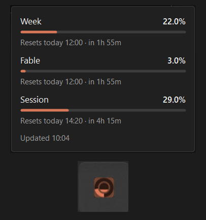

# Ember

A Windows tray icon that shows how much of your Claude plan you've burned through this week.



The ring is the weekly limit, filling clockwise from the bottom. The centre fills from the bottom as the current five-hour session is used up. Hover for the exact figures, including any model-specific weekly limit (Fable, at the time of writing) and when each one resets.

## Requirements

- Windows 10 or 11
- [.NET 10 Desktop Runtime](https://dotnet.microsoft.com/download/dotnet/10.0)
- Claude Code, signed in with a Claude subscription

Ember reads the token Claude Code keeps in `%USERPROFILE%\.claude\.credentials.json` (or `%CLAUDE_CONFIG_DIR%` if set) and polls the same endpoint Claude Code's `/usage` command uses, once a minute.

The token only lasts a few hours. Claude Code refreshes it while it's running, so Ember leaves it alone then. If Claude Code isn't running when the token is about to expire, Ember refreshes it itself and writes the new one back to the credentials file for Claude Code to pick up.

## Building

```
dotnet build -c Release
```

or, for a single exe:

```
dotnet publish -c Release -r win-x64 --self-contained false -p:PublishSingleFile=true
```

The result is in `bin\Release\net10.0-windows\win-x64\publish\`.

## Using it

Left-click refreshes. Right-click for Refresh, Open usage page, Start with Windows, and Quit.

Windows 11 tucks new tray icons into the overflow area. Drag it onto the taskbar, or turn it on under Settings > Personalization > Taskbar > Other system tray icons, if you want it always visible.
